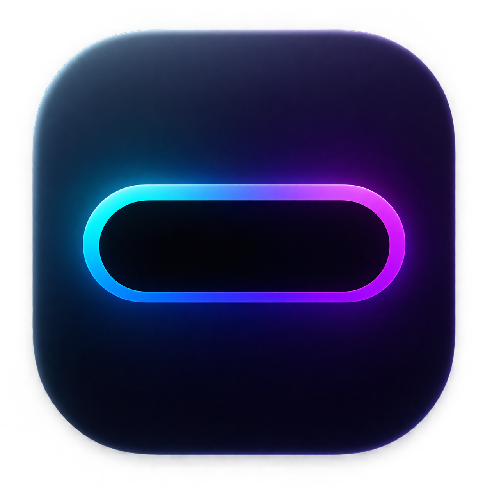

# Dynamic Notch

### Turn your MacBook notch into a smart control center.

 

 

---
---
-
## ✨ Features

| | Feature | |
|---|---|---|
| 🎵 | **Media Controls** | Artwork, title, artist, play/pause, next, previous and seek |
| 🔊 | **Volume** | Control system volume directly from the notch |
| ☀️ | **Brightness** | Display brightness controls and hardware HUD |
| ⏱️ | **Timer** | Quick presets and custom timers |
| 📋 | **Clipboard** | Text, files, folders and clipboard history |
| 📁 | **File Shelf** | Drag & drop temporary files into the notch |
| 📅 | **Agenda** | Calendar events and meeting links |
| 🔋 | **Battery** | Quick battery status |
| 🖥️ | **Multi Display** | Built-in and external monitor support |

---

## 🚀 Installation

1. Download the latest **DMG** from [Releases](../../releases/latest)
2. Open `DynamicNotch-v1.0.1.dmg`
3. Drag **Dynamic Notch** into **Applications**
4. Launch the app

### macOS security

Dynamic Notch is currently distributed outside the Mac App Store.

If macOS blocks the first launch:

**System Settings → Privacy & Security → Open Anyway**

You only need to do this the first time.

---

## 🔐 Permissions

Dynamic Notch may require:

**Accessibility**  
Required for media controls.

**Calendar**  
Required for Agenda events.

> Dynamic Notch processes its data locally on your Mac.

---

## 🛠 Tech Stack

 

**Swift · SwiftUI · AppKit · Combine · EventKit · CoreGraphics**

---

## 💻 Compatibility

Designed primarily for **MacBook models with a physical notch**.

Some media and display features use private and may be affected by future macOS updates.

---

### 📦 Current Release

## v1.0.1

[Download Dynamic Notch](../../releases/latest)

 

## Copyright

© 2026 Francesco Aloisio. All rights reserved.

This project is publicly available for viewing and portfolio purposes.
No permission is granted to copy, modify, redistribute, or use the source code without explicit authorization from the author.

Made with Swift for macOS 

